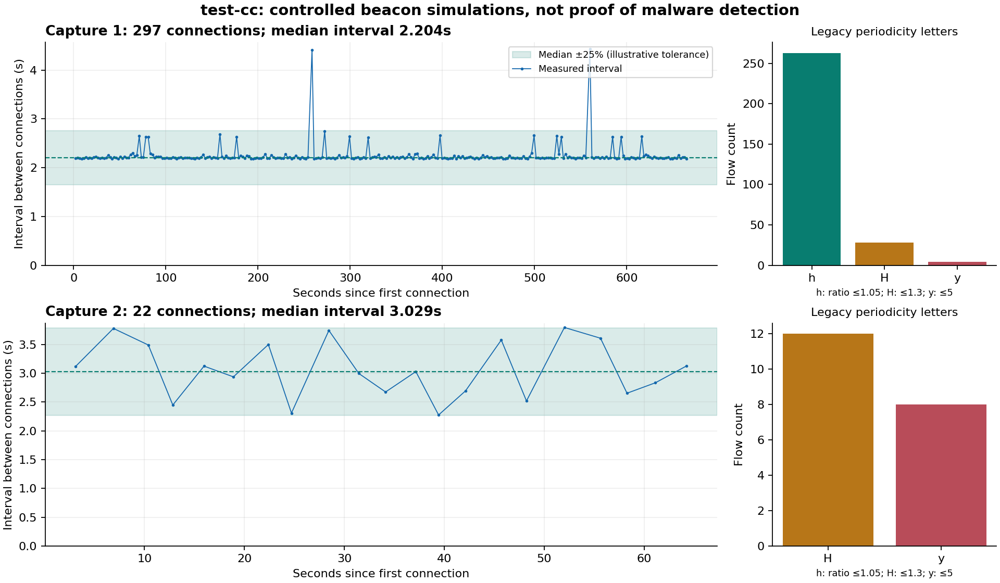

# C2 detection: audit and proposed redesign

This is a design proposal, not a description of a new deployed detector.
The audit used branch revision `f21589a7f` on 24 October 2026. The two
`dataset/test-cc` captures are controlled simulations, as confirmed by their
author. No malware was executed, no network capture was started, and the
running detector was not changed for this study.

## Recommendation

Keep the original idea: describe how one client repeatedly communicates with
one service using timing, duration, and traffic size. Keep those measurements
as numbers rather than turning them into a small alphabet before detection.

Start with a lightweight statistical detector that estimates the usual interval
and allows variation, missed callbacks, bursts, and inactive periods. It can
recognize beacon-like traffic without needing a large malware training set.
Then combine that behavior with other evidence to decide how suspicious the
channel is. Add a small trained classifier when we have reliable examples of
both C2 channels and legitimate automated traffic.

No algorithm can distinguish two channels with identical observed behavior
just because one belongs to malware. Regularity is evidence of automation;
it is not proof of malware. The importance of distinguishing legitimate and
malicious beacons is also central to
[BAYWATCH](https://research.ibm.com/publications/baywatch-robust-beaconing-detection-to-identify-infected-hosts-in-large-scale-enterprise-networks).

## What is wrong with the current implementation

The relevant code is in
[`rnn_cc_detection.py`](../modules/rnn_cc_detection/rnn_cc_detection.py),
[`symbols_handler.py`](../slips_files/core/helpers/symbols_handler.py),
[`profile_handler.py`](../slips_files/core/database/redis_db/profile_handler.py),
and the
[training script](../modules/rnn_cc_detection/training_code/train_optimization_optuna.py).

| Finding | Consequence |
| --- | --- |
| The input check requires the text `established` inside `flow.state`. The actual Zeek parser preserves `SF` for the completed TCP connections in both captures. | These flows are skipped before prediction. A direct replay makes zero model calls for `SF`, one for `Established`, and incorrectly one for `Not Established`. |
| Training pads with numeric `0`; runtime pads with the character `"0"`, encoded as `45`. Actual letter `a` is encoded as `0`, while the stored embedding also uses `mask_zero=True`. | Training and inference do not agree about missing observations. Padding is also mixed with real symbols. The next model needs a distinct padding representation and identical preprocessing at training and inference. |
| Input is truncated with `sequence[:500]`. | After the first 500 characters, later behavior cannot change the model input. Two different suffixes produce identical inputs in a direct check. |
| Confidence is `min(1, number_of_characters / 100)`. | Punctuation and long-gap symbols count as observations. Confidence does not measure the number of independent connections, the elapsed observation period, or error rates. |
| The model threshold is fixed at `0.99`. | A high sigmoid output is treated as a decision threshold without demonstrated calibration for new networks or a measured false-alert budget. It is not a 99% guarantee that the channel is C2. |
| The complete growing letter string is stored and published, even after inference ignores its suffix. | Long sequences cause repeated copying and transmission. Inference also repeatedly evaluates a padded 500-character sequence. |
| Timing history belongs to a profile/time-window tuple. | A channel is fragmented across ordinary time-window boundaries, making slow callbacks and returning activity harder to recognize. |

The padding problem has a measurable effect with the shipped `rnn_model.h5`.
For the same 42-character sequence from capture 2, the model returns about
**0.99977** with runtime padding and **0.22467** with the training script's
numeric padding. This comparison bypasses the broken state check to isolate
preprocessing. It does not establish which output is correct, nor validate
simulated beacon traffic as malware. Changing padding alone is not a safe
replacement for retraining and evaluation.

## What the test captures contain

An offline Zeek extraction produced these measurements for the main TCP channel
in each capture. Sizes below are total application bytes reported by Zeek,
matching the bytes used by the current letter generator.

| Measurement | Capture 1 | Capture 2 |
| --- | --- | --- |
| Total capture duration | 665.08 seconds | 67.50 seconds |
| Main channel | `147.32.80.37 → 141.193.213.21:443/tcp` | `147.32.80.37 → 141.193.213.20:443/tcp` |
| Connections in that channel | 297 | 22 |
| Median interval between starts | 2.204 seconds | 3.029 seconds |
| Interval range | 2.180–4.429 seconds | 2.276–3.796 seconds |
| Total bytes per connection | 4,720–4,753 | 6,842–6,869 |
| Intervals within ±25% of their median | 99.3% | 95.2% |
| Legacy periodicity letters after the first two flows | 263 `h`, 28 `H`, 4 `y` | 12 `H`, 8 `y` |

Both use TLS SNI `testing.com`. Capture 1 also has two connections to
`141.193.213.20`; two observations do not establish a recurring channel.
Those two connections share the observed SNI `testing.com` with the main
channel. Combining the 299 connections using that direct TLS association
removes the apparent doubled intervals: the range becomes 2.180–2.744 seconds,
with all intervals within ±25% of the median. The longer per-IP gaps in the
figure are explained by switching server IPs, not missing callbacks. This
is a concrete reason to retain both endpoint details and a service-level view.
Capture 2 additionally contains 241 UDP connections, mostly DNS. Its repeated
DNS queries must not all be labeled C2 merely because they share a capture
with the simulation.



The green region is an illustrative tolerance, not a validated production
threshold. These files test strict and variable callback timing. They do not
test hours-long callbacks, long inactive periods, persistent encrypted
connections, or false alerts on representative legitimate traffic.

The extraction can be reproduced from the repository root with:

```sh
mkdir -p output/cc-strategy/capture-1 output/cc-strategy/capture-2
zeek -C -r dataset/test-cc/test-cc-capture-1.pcap LogAscii::use_json=T 'Log::default_logdir=output/cc-strategy/capture-1'
zeek -C -r dataset/test-cc/test-cc-capture-2.pcap LogAscii::use_json=T 'Log::default_logdir=output/cc-strategy/capture-2'
```

## Why continuous features help

The existing symbols use three size groups, three duration groups, and four
periodicity groups once enough flows exist. For example, everything above
1,100 bytes has the same size group; a 2-second interval and a 4-second
interval use the same `.` time character. Near a threshold, a small numerical
change can produce a different symbol.

Changing a symbol's integer code into a float does not recover the lost
measurement. Read the original flow values instead:

| Measurement | What it tells us and why it matters |
| --- | --- |
| Time between connection starts, in seconds | Finds the callback interval and frequency without assuming a particular malware family or a fixed number of seconds. |
| Time from the previous connection's end to the next start | Distinguishes a fixed sleep after a response from an interval measured between starts. A slow server can otherwise look like extra jitter. Keep overlap as a separate flag. |
| Bytes and packets in each direction | Describes the repeated exchange. Keeping directions separate avoids losing a stable small request when response size varies. |
| Connection duration | Helps separate quick check-ins, long polling, and large task/result transfers. |
| Variation in intervals, sizes, and durations | Describes how consistent the channel is while allowing occasional commands and larger responses. |
| Callback count, observation span, gaps, and recent activity | Separates limited evidence from a well-observed pattern and distinguishes a paused channel from a changed one. |
| Connection outcome and available protocol context | Separates answered exchanges from retries, and adds evidence such as a rare destination or unusual TLS/HTTP behavior. |

Keep absolute timestamps as float64 or integer microseconds. Epoch timestamps
stored as float32 lose too much timing precision. Original byte/packet counts
remain integers; derived or transformed features can use float32. Logarithmic
transforms such as `log1p(bytes)` help compare very different scales without
discarding the original values needed to explain an alert.

## Timing strategy: recurring activity with interruptions

For each channel, estimate its usual interval from recent observations using
the median. Measure spread using median absolute deviation and quantiles,
which tolerate occasional unusual connections better than a mean and standard
deviation alone. The shared
[`anomaly_detection.py`](../slips_files/common/anomaly_detection.py) already
provides these statistics.

Score several aspects separately:

1. **Interval consistency:** how much callback intervals vary relative to
   their usual interval. Compare both start-to-start and non-overlapping
   end-to-start intervals, accounting for the extra model choice during
   calibration.
2. **Repeated exchange:** whether request/response sizes and durations have
   a recurring pattern. A small stable check-in may be interrupted by a much
   larger command response; that should not erase the smaller pattern.
3. **Persistence:** whether there are enough observations over enough elapsed
   time to support the finding. Two regular-looking callbacks are insufficient.
4. **Interruptions and return:** whether similar behavior returns after a gap,
   and whether unusual bursts are followed by the usual check-ins again.

Maintain short, medium, and long histories. Recent observations allow the
interval to change; longer summaries retain evidence across quiet periods.
Keep the channel's state across Slips time windows and checkpoints across
restarts, subject to explicit retention and memory limits.

Use a small state machine initially: **collecting**, **recurring**, **paused**,
and **changed**. These describe the evidence currently available, not benign
or malicious labels. A quiet period should reduce confidence that the channel
is active without immediately forgetting its previous behavior.

For missing scheduled callbacks, test a small, capped number of multiples of
the estimated interval and charge a penalty for each missing observation.
Do not allow an arbitrary tiny interval to explain every long gap as thousands
of missed callbacks. A long pause should be represented explicitly.

Some implants sleep for a random interval after each response; others run on
a clock. The first accumulates timing drift even while behaving as designed.
A global phase-alignment or Fourier peak alone would miss important cases.
Burst grouping also needs care: merging every closely spaced connection would
erase a genuinely fast beacon. Compare the original observations with a bounded
burst summary rather than permanently discarding them.

There is no universal C2 frequency. A connection every second and one every
six hours can both be suspicious. Twelve callbacks at a one-hour interval
require at least eleven hours of observation. Configured retention must be
long enough to cover the slowest interval and minimum observation count we
claim to support.

## Which algorithms to compare

| Approach | Role in this redesign |
| --- | --- |
| Robust interval and size statistics plus the activity state machine | First implementation. Low computation, understandable alerts, and no malware labels required to recognize repeated behavior. Thresholds still need validation against legitimate traffic. |
| Regularized logistic regression or shallow gradient-boosted trees on channel summaries | First supervised comparisons once labels are reliable. They can combine timing, sizes, gaps and context without a large sequence network. Compare their false-alert rate and detection delay; neither is automatically the best. |
| Hidden Markov or semi-Markov model | Later experiment if explicit active/quiet states and their durations improve results enough to justify additional fitting and complexity. |
| Continuous-feature GRU/TCN or MiniRocket-based classifier | Later benchmark when there are enough independent labeled sequences. Keep actual time gaps as inputs and define how unequal-length sequences are represented. Extra model capacity must earn its CPU and memory cost. |

The original high-level idea has precedent in
[BotFinder's flow-based C2 models](https://conferences.sigcomm.org/co-next/2012/eproceedings/conext/p349.pdf).
The [MiniRocket paper](https://arxiv.org/abs/2012.08791) provides a useful
efficient sequence-classification comparison, but its time-series benchmark
results do not establish accuracy on Slips C2 traffic.

Keep this work in the C2 detector. Service-behavior anomaly detection answers
a different question: whether a host receives connections from unexpected
clients or at unusual times. Share statistical and bounded-storage helpers
without making C2 detection wait for that module's training period.

## Training when malware examples are scarce

Separate three activities that are currently easy to confuse:

- **Estimate the channel's behavior:** calculate its interval and variation
  from the traffic being inspected. This does not label it benign.
- **Calibrate false alerts:** use trusted legitimate traffic, especially
  automated traffic such as updates, monitoring, synchronization, backups,
  DNS and telemetry. Set thresholds using a held-out portion of that traffic.
- **Learn which patterns are C2:** use reviewed channel labels from real
  malware captures and controlled simulations. Keep the source of each label
  and evaluate real malware separately from simulations.

Do not automatically treat a host's first hour or first day as clean training.
An infection already present during that period must still be detectable.
Likewise, peer reports are context, not independent local callbacks or trusted
training labels.

The current training script maps every label containing `Botnet` or `Malware`
to its positive class. With its default preprocessing, the supplied main TSV
retains **2,228 of 7,631 rows**. Only **59** retained labels explicitly contain
`CC`; other positives include DNS, spam, and connection attempts. Some of the
less specific labels may also contain C2, but they need review rather than
automatic relabeling as confirmed C2 channels.

The script also randomly splits rows: **75 of 446 test inputs** exactly match
an input present in training. This does not prove they are copies of the same
capture, but it weakens the independence of the evaluation. Its Optuna branch
repeatedly evaluates choices on the nominal test split, so that split is used
for tuning rather than a final independent test.

For the redesign:

1. Recover raw flows for verified historical C2 channels where available.
   The old letters cannot be converted back into precise numbers. Keep those
   datasets as a legacy benchmark when raw observations are unavailable.
2. Label actual C2 channels, background malware traffic, legitimate automation,
   human traffic, and unresolved cases separately. Do not force unresolved
   channels into either class.
3. Generate controlled variations: strict and one-sided/two-sided jitter,
   missed callbacks, pauses, changing intervals, task bursts, rotating servers,
   and failed connection attempts. Include both legitimate and malicious uses
   of similar schedules. Simulations test coverage; they do not prove real
   malware detection or replace representative negative traffic.
4. Split by complete capture/session and, where possible, malware family,
   device and collection period. Keep all windows and synthetic descendants
   of a source session on the same side of the split.
5. Tune on training/validation only. Reserve unseen families, later captures,
   and separate networks for final evaluation. Report uncertainty when the
   number of independent malicious channels is small.

The useful measurements are precision, recall, false alerts per host-day,
time to first detection, CPU, and memory. Overall accuracy on a small mixed
collection is insufficient for a detector that watches many legitimate channels.

## Configuration and resource limits

The following are proposed controls, not settings that the current module
already recognizes. Initial values must be validated rather than declared safe
defaults after testing only two simulations.

| Control | What it changes and why |
| --- | --- |
| Minimum callback count | How many independent connection observations are required before reporting recurring behavior. Start comparisons around 8–12; lower values report sooner with weaker evidence. |
| Allowed interval variation | How far intervals may deviate from the estimated interval, expressed as a fraction. At `0.25`, an estimated 60 seconds permits 45–75 seconds. This is a detector tolerance, not necessarily the jitter percentage configured in a C2 framework. |
| Required matching fraction | How many intervals must fit the tolerance, for example 80%. Allows some gaps and command bursts without letting a few matching intervals dominate. |
| Minimum and maximum callback interval | Which timescales to examine. A broad range gives slow beacons a chance; it also requires enough retention and observations to support them. |
| Pause and missing-callback limits | How long to retain a quiet channel and how many missing cycles may support an interval estimate. Prevents both premature forgetting and explaining arbitrary traffic as periodic. |
| Recent event buffer and channel cap | Bounds memory regardless of capture duration. A prototype could compare 128 recent events per channel and 4,096 channels, with compact numeric arrays and explicit eviction counters. |
| Evaluation interval and new-event requirement | Limits expensive recalculation, for example after four new observations and no more than once every five seconds per channel once initial evidence is sufficient. Keep event ingestion cheap. |
| Evidence cooldown | Limits repeated alerts for the same unchanged finding. Retain the observed count, last occurrence and supporting flow UIDs instead of emitting a duplicate for every callback. |

Consume the existing numeric `new_flow` events rather than add another complete
growing sequence to Redis. Use only the initiating host's copy; deduplicate
flow UIDs and handle bounded out-of-order delivery explicitly. Use the parsed
connection outcome, not substring matching of vendor-specific state names.

The primary channel key should preserve the original client/service grouping:
network, stable local host identity, remote IP, destination port and transport.
Ignore the ephemeral source port. Optionally relate changing remote IPs through
observed DNS/SNI evidence for the same service, while preserving the underlying
endpoint records. Do not merge unrelated tenants merely because they share a
CDN, certificate or provider.

Keep bounded numeric state locally, checkpoint in short batches using existing
SQLite writer-lock rules, and reuse shared statistical helpers. No unbounded
Redis history and no full-history scans on each arriving flow. These are design
requirements; actual CPU/memory costs still need measurement on the Mac and Pi.

## Limits and rollout

A single long-lived TLS connection may carry many C2 messages while producing
only one Zeek connection record. Connection-summary analysis cannot recover
those internal callback times. Detecting them needs additional packet/burst or
application observations from Zeek. Long-connection findings remain useful,
but do not provide the missing timing measurements.

Start by repairing and documenting the legacy input/encoding contract and
recording its real baseline. Then implement the numeric detector in evaluation
mode, compare it with that baseline, and calibrate on legitimate automation.
Enable analyst-visible suspicious-channel evidence before considering stronger
automatic prevention decisions. Periodicity alone should not justify blocking
a destination as confirmed malicious.

Preserve the existing module/configuration identity during migration and
version the new numeric feature format. Compare old and new results without
emitting duplicate evidence. Keep the letter exporter available for existing
workflows while moving detection away from complete growing letter strings.

Use the two test captures as regression cases, add missing-beacon/pause/slow
and persistent-connection cases, and measure false alerts on independent
legitimate traffic. Select a trained classifier only after it improves that
evaluation over the simple statistical implementation.
