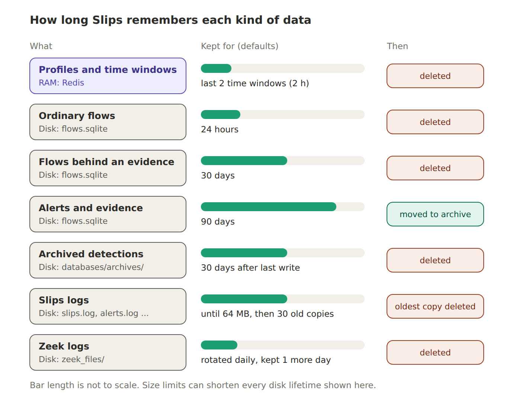
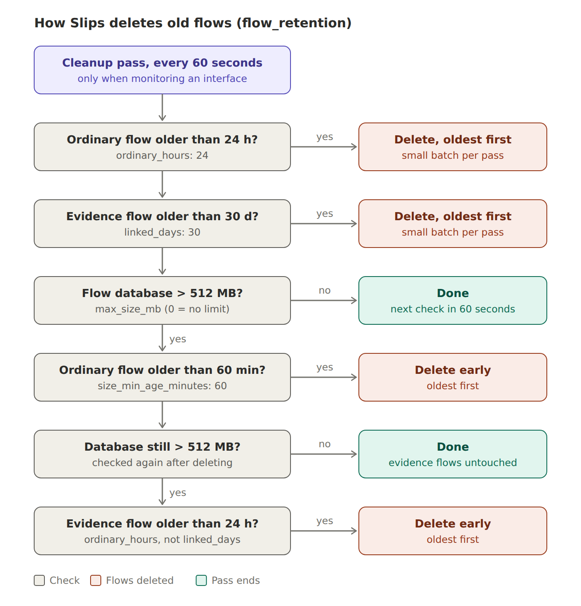
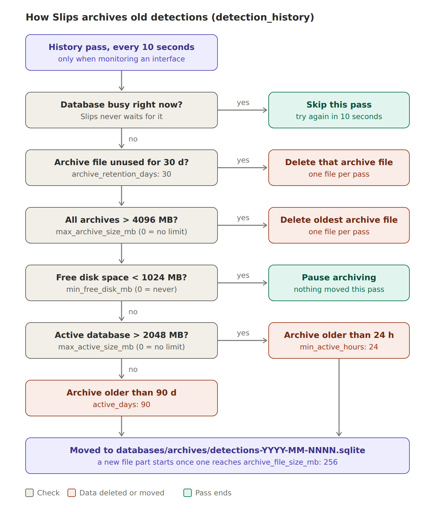
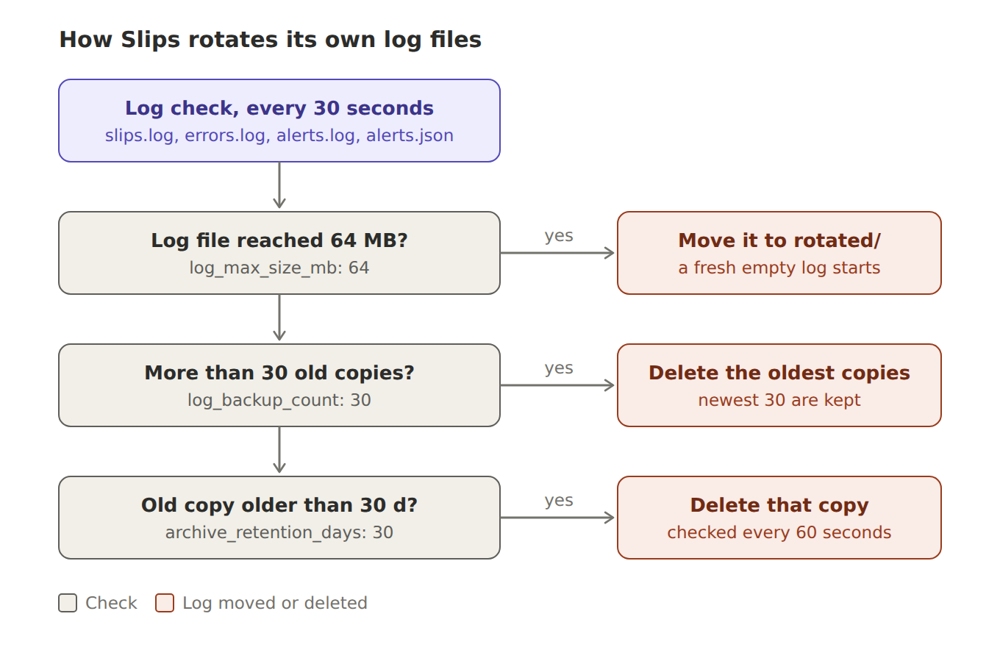

# How Slips forgets the past

**Contents**

- [What is kept, and for how long](#what-is-kept-and-for-how-long)
- [Does this apply to my run?](#does-this-apply-to-my-run)
- [RAM: old time windows](#ram-old-time-windows)
- [Disk: flows](#disk-flows)
- [Disk: alerts and evidence](#disk-alerts-and-evidence)
- [Disk: Slips logs](#disk-slips-logs)
- [Disk: Zeek logs](#disk-zeek-logs)
- [Common setups](#common-setups)
- [How do I know it is working?](#how-do-i-know-it-is-working)
- [Questions](#questions)

Slips can monitor a network for weeks or months. If it kept every flow, every
alert and every log line forever, it would fill your RAM and your disk.

So Slips forgets old data on purpose. This page explains what it forgets, when,
and how to change it.

**The short version**

- You do not need to do anything. The defaults keep Slips bounded.
- Recent data is always kept. Only old data is removed.
- Flows that caused a detection are kept much longer than ordinary flows.
- Alerts and evidence are archived before they are deleted.
- Every limit can be changed, or turned off, in `config/slips.yaml`.


## What is kept, and for how long



| Data | Where it lives | Kept for (default) | Then | Config section |
|---|---|---|---|---|
| Profiles and time windows | RAM (Redis) | the current time window and the one before it | deleted | `time_window_width` |
| Ordinary flows | `<output_dir>/databases/flows.sqlite` | 24 hours | deleted | `flow_retention` |
| Flows behind an evidence | `<output_dir>/databases/flows.sqlite` | 30 days | deleted | `flow_retention` |
| Alerts and evidence | `<output_dir>/databases/flows.sqlite` | 90 days | moved to an archive file | `detection_history` |
| Archived alerts and evidence | `<output_dir>/databases/archives/` | 30 days after the last write | deleted | `detection_history` |
| Slips logs | `<output_dir>/` and `<output_dir>/alerts/` | until the file reaches 64 MB | old copies kept, then deleted | `detection_history` |
| Zeek logs | `<output_dir>/zeek_files/` | rotated every day, kept 1 more day | deleted | `parameters` |


## Does this apply to my run?

| How you run Slips | Flows and detections cleaned up? | Why |
|---|---|---|
| On an interface (`-i`, `-g`, access point mode) | Yes | The traffic never ends, so the data would grow forever. |
| On a pcap or a log file (`-f`) | No | The input has an end, so the data has a known size. Slips keeps all of it for you to review. |

RAM cleanup happens in both cases.


## RAM: old time windows

Slips splits the traffic of each IP into time windows (1 hour each by default).
Detections only need the recent ones.

- When a time window closes, Slips deletes the time windows older than the
  previous one from Redis.
- So at any moment, RAM holds the current time window and the one before it.
- Helper data (for example DNS resolutions) expires on its own after a couple
  of time windows.

Nothing to configure here, other than `time_window_width`. A smaller time
window means less data in RAM.

Deleting from RAM does not lose your detections: alerts, evidence and flows
are stored on disk as described below.


## Disk: flows

Slips stores every flow it reads in `flows.sqlite`. This is the fastest growing
file of a long run.

Slips sorts flows into two groups:

- **Ordinary flows**: flows that never caused any evidence. Kept for a short
  time.
- **Evidence flows**: flows that are part of an evidence. Kept for a long time,
  so you can still see the traffic behind an alert weeks later.

Every 60 seconds, Slips does the following:



In words:

1. **Age limit.** Ordinary flows older than `ordinary_hours` are deleted.
   Evidence flows older than `linked_days` are deleted.
2. **Size limit.** If the database is still bigger than `max_size_mb`, Slips
   deletes flows earlier than their age limit, oldest first:
   - first ordinary flows, but never ones younger than `size_min_age_minutes`.
   - then, only if that was not enough, evidence flows older than
     `ordinary_hours`.

Good to know:

- Each pass deletes a small batch, so cleanup never slows down the analysis.
  A large backlog is cleared over several passes.
- A new evidence on an old flow makes that flow "young" again.
- Whitelisted evidence does not protect a flow.
- If `max_size_mb` is small, evidence flows may live for `ordinary_hours`
  instead of `linked_days`. Raise `max_size_mb` if you need the full
  `linked_days`.

```yaml
flow_retention:
  enabled: true
  ordinary_hours: 24
  linked_days: 30
  max_size_mb: 512
  size_min_age_minutes: 60
```

| Option | Meaning |
|---|---|
| `enabled` | `false` keeps all flows forever. The database grows without limit. |
| `ordinary_hours` | Hours to keep flows that are not part of any evidence. |
| `linked_days` | Days to keep flows that are part of an evidence. |
| `max_size_mb` | Size the flow database should stay under. `0` means no size limit. |
| `size_min_age_minutes` | Flows younger than this are never deleted because of size. |


## Disk: alerts and evidence

Alerts and evidence are much smaller than flows and much more valuable, so
Slips keeps them longer and archives them before deleting them.

They go through two stages:

| Stage | Where | How to read it |
|---|---|---|
| Active | `<output_dir>/databases/flows.sqlite` | The web interface |
| Archived | `<output_dir>/databases/archives/detections-YYYY-MM-NNNN.sqlite` | Any SQLite tool, for example `sqlite3 <file>` |

Every 10 seconds, Slips does the following:



In words:

1. **Old archives are deleted.** An archive file that was not written to for
   `archive_retention_days` is deleted. If all archives together are bigger
   than `max_archive_size_mb`, the oldest file is deleted early.
2. **Low disk check.** If free disk space is below `min_free_disk_mb`, Slips
   stops archiving until there is room again. Archiving writes new files, and
   Slips will not fill the last of your disk with them.
3. **Old detections are archived.** Detections older than `active_days` move
   from the active database to this month's archive file.
4. **Size limit.** If the active database is bigger than `max_active_size_mb`,
   detections move to the archive earlier, but never ones younger than
   `min_active_hours`.

Good to know:

- There is one archive file per month. When a file reaches
  `archive_file_size_mb`, Slips starts a new part (`-0001`, `-0002`, ...).
- Each archive file is a normal SQLite database. You can copy it elsewhere to
  keep it forever.
- If the database is busy, Slips skips the pass and tries again 10 seconds
  later. Analysis always goes first.

```yaml
detection_history:
  enabled: true
  active_days: 90
  max_active_size_mb: 2048
  min_active_hours: 24
  archive_retention_days: 30
  archive_file_size_mb: 256
  max_archive_size_mb: 4096
  min_free_disk_mb: 1024
  log_max_size_mb: 64
  log_backup_count: 30
```

| Option | Meaning |
|---|---|
| `enabled` | `false` turns off archiving and log rotation. History grows without limit. |
| `active_days` | Days detections stay in the active database. |
| `max_active_size_mb` | Size the active database should stay under. `0` means no size limit. |
| `min_active_hours` | Detections younger than this are never archived because of size. |
| `archive_retention_days` | Days an archive file is kept after its last write. |
| `archive_file_size_mb` | Size of one archive file before a new part starts. |
| `max_archive_size_mb` | Size all archives together should stay under. `0` means no size limit. |
| `min_free_disk_mb` | Archiving pauses when free disk space is below this. `0` means never pause. |


## Disk: Slips logs

`slips.log`, `errors.log`, `alerts.log` and `alerts.json` only ever grow.
Slips rotates them: a full log is moved aside and a fresh one starts.



- Old copies are stored in a `rotated/` directory next to the log, for example
  `<output_dir>/alerts/rotated/alerts.log.20260101T120000.<id>`.
- The newest `log_backup_count` copies are kept. Copies older than
  `archive_retention_days` are deleted.
- In daemon mode `slips.log` is not rotated.

| Option | Meaning |
|---|---|
| `log_max_size_mb` | A log is rotated once it reaches this size. |
| `log_backup_count` | How many old copies of each log to keep. |

Both options are in the `detection_history` section.


## Disk: Zeek logs

Zeek writes its own log files, which Slips reads. On an interface they are
rotated every day and the rotated files are deleted one day later.

This is controlled by `rotation`, `default_rotation_interval` and
`keep_rotated_files_for` in the `parameters` section. See
[Rotation of zeek logs](usage.md#rotation-of-zeek-logs).


## Common setups

| I want to... | Change this |
|---|---|
| Run on a small disk (Raspberry Pi, router) | Lower `max_size_mb`, `max_active_size_mb` and `max_archive_size_mb`. Lower `log_backup_count`. |
| Keep the traffic behind alerts for longer | Raise `linked_days`, and raise `max_size_mb` so the size limit does not delete them early. |
| Keep alerts for a year | Set `active_days: 365`, and raise `max_active_size_mb`. |
| Limit by age only, never by size | Set `max_size_mb: 0`, `max_active_size_mb: 0` and `max_archive_size_mb: 0`. |
| Keep everything forever | Set `enabled: false` in both `flow_retention` and `detection_history`. Watch your disk. |


## How do I know it is working?

Slips prints a line every time it removes something, and says why:

```text
Deleted 500 old flow(s) because they were older than 24h (ordinary) / 30d (linked to evidence), or the flows database exceeded max_size_mb=512.
Rotated alerts.log because it reached log_max_size_mb=64. Old copies are kept in <output_dir>/alerts/rotated.
Deleted expired detection history archive(s) because they were older than archive_retention_days=30 or the archives exceeded max_archive_size_mb=4096.
```


## Questions

**Will I lose an alert because of this?**
Not for a long time. With the defaults an alert stays in the active database
for 90 days, then at least 30 more days in an archive file. `alerts.log` and `alerts.json` also
keep their own copies.

**An old alert has no flows under it. Why?**
The flows behind it passed `linked_days`, or the flow database went over
`max_size_mb`. The alert and its evidence are still there.

**The flow database file did not shrink after a cleanup. Why?**
Slips gives freed space back to the disk a little at a time. The freed space
is reused for new flows in the meantime, so the file stops growing first and
shrinks later.

**Is deleted data gone for good?**
Yes. Deleted flows, deleted archive files and deleted log copies cannot be
recovered. Copy what you need out of `<output_dir>` before it expires.
