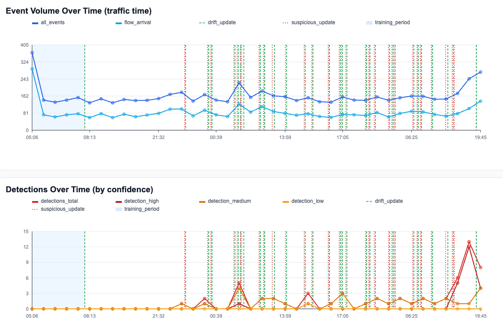

# HTTPS Anomaly Detection Module

This document describes how the `anomaly_detection_https` module detects anomalies from TLS/HTTPS traffic in Slips.

## Goal

Detect unusual HTTPS behavior per host, using:

- Hourly behavior changes (volume and novelty patterns).
- Flow-level deviations (for known servers).
- Adaptive baselines that update over time, with poisoning resistance.

## Input data used

The module subscribes to SSL/TLS events and reads related connection metadata from DB for the same UID.

Main fields used:

- SSL: `uid`, `server_name` (SNI), `ja3`, `ja3s`, `dport`, `sport`
- Conn (correlated): destination IP, total bytes, timing info

## Traffic-time logic

All detection windows are based on **traffic timestamps** (packet/log time), not wall clock time.

This keeps behavior consistent for:

- live interface capture,
- live Zeek folder input,
- offline PCAP,
- offline Zeek logs.

## Features

The module computes per-host hourly features:

- `ssl_flows`: number of SSL flows in the hour.
- `unique_servers`: number of distinct destination servers.
- `new_servers`: number of servers not seen before for that host.
- `ja3_changes`: number of new JA3 variants seen per server in the hour.
- `known_server_avg_bytes`: mean bytes for flows to already-known servers.

Flow-level feature:

- `bytes_to_known_server`: per-server bytes deviation on each flow.

## Baseline and training

Each host has independent models.

### Training phase (`training_hours > 0`)

For the configured number of observed hours, the module learns from traffic
assumed to be normal. It learns separately for each host. An hour counts when
Slips closes a clock-hour group containing HTTPS activity, usually when a later
hour's record arrives. Empty hours between records do not count. Use whole
numbers for `training_hours`; this setting does not support a one-minute wait.

During training:

- no detection decisions are emitted from hourly z-score rules before training ends,
- normal averages and variation are learned using `training_fit_method`.

Training fit technique is selected by `training_fit_method`:

- `training_fit_method = welford` -> Welford benign fit.
- `training_fit_method = ewma` -> EWMA-style training adaptation.

When `training_fit_method = ewma`, `training_alpha` controls strength:

- higher `training_alpha` = faster adaptation,
- lower `training_alpha` = slower adaptation.

`training_alpha` is ignored with `welford`. With `ewma`, a value of `1` uses
the newest value for the learned average; it does not give all examples equal
weight or switch to Welford training.

### No explicit training (`training_hours = 0`)

Detection starts immediately using online adaptation.

Special fallback only for `ja3_changes`:

- if hourly `ja3_changes < ja3_min_variants_per_server`, that hourly count is
  not checked. The count combines newly observed client TLS fingerprints
  across the host's servers, despite the setting's `per_server` name.

Skipping the training wait does not remove `min_baseline_points`: numerical
checks still need previous measurements. Direct warnings about a new server
or a new server TLS fingerprint do not need that measurement count.

## Scoring

Each modeled feature uses robust scoring in three explicit steps:

1. Transform heavy-tail signals: `y = log(1 + x)` (`log1p`) for non-negative count/bytes features.
2. Estimate robust center/scale on recent transformed values:
   - `m = median(y)`
   - `MAD = median(|y - m|)`
   - `sigma_robust = max(1.4826 * MAD, min_std_floor)`
3. Score deviation:
   - `z_robust = |y_t - m| / sigma_robust`

Why this is used:

- HTTPS counts and byte volumes are typically right-skewed and heavy-tailed,
- mean/std-only scoring overreacts to bursts and underreacts after outliers,
- `log1p + median/MAD` is more stable under non-Gaussian traffic.

Thresholds:

- empirical thresholds calibrated from benign training when `training_hours > 0`,
- otherwise defaults (`hourly_zscore_threshold`, `flow_zscore_threshold`).

Calibration rule:

- per measurement type, collect difference scores from traffic assumed normal during training,
- set threshold to high benign quantile (`empirical_threshold_quantile`, default 0.995),
- fallback to defaults if training data is insufficient.

## Adaptation states

After each hour closes, the module chooses model update mode.

Update event semantics:

- `training_fit`:
  initial benign baseline fit while `trained_hours < training_hours`;
  uses `training_fit_method`; only `ewma` uses `training_alpha`.
- `baseline_update`:
  normal post-training adaptation; uses EWMA with `baseline_alpha`.
  In ADWIN mode, this is used when ADWIN does not signal drift.
- `drift_update`:
  post-training drift adaptation; uses EWMA with `drift_alpha`.
  In ADWIN mode, this is used only after ADWIN drift signal and small/drift-like classification.
- `suspicious_update`:
  post-training conservative adaptation; uses EWMA with `suspicious_alpha`.
  In ADWIN mode, this is used only after ADWIN drift signal and suspicious classification.

When `use_adwin_drift=false`:

1. `training_fit`
   During initial training: learn using `training_fit_method`.

2. `drift_update`
   If anomaly score is small (`hourly_score <= adaptation_score_threshold`) and flow anomaly count is small (`<= max_small_flow_anomalies`), update with `drift_alpha`.

3. `suspicious_update`
   Otherwise update with `suspicious_alpha` (much smaller), to limit poisoning.

For normal non-anomalous periods outside training, per-feature EWMA uses `baseline_alpha`.

### ADWIN drift trigger (`use_adwin_drift=true`)

If `use_adwin_drift=true` and `river` is installed, ADWIN is the only drift trigger in both paths:

- **Hourly path**: ADWIN receives each raw hourly feature stream.
- **Flow path**: ADWIN receives each raw per-flow signal stream.
- ADWIN drift detected -> classify as `drift_update` or `suspicious_update` using existing thresholds.
- No ADWIN drift -> use `baseline_update` (`baseline_alpha`), even if anomalies exist.
- During training, ADWIN also receives the raw measurements so it has previous examples when training ends.

Why raw signals:

- drift is a distribution change in the observed variables, so ADWIN tracks the raw feature streams directly,
- z-scores are still used for anomaly magnitude and evidence reasons, but not as the primary drift input.

Performance note:

- hourly ADWIN cost scales with hourly feature count,
- flow ADWIN cost scales with per-flow signal count,
- both are constant-time scalar updates and usually lightweight.

Current tuned defaults for faster ADWIN reaction:

- `adwin_delta: 0.01`
- `adwin_clock: 1`
- `adwin_grace_period: 5`
- `adwin_min_window_length: 5`

## New server vs JA3 behavior

- `new_servers` is modeled as an hourly statistical feature and adapted over time.
- `new_server` can also appear as a direct flow-level novelty reason.
- `ja3_changes` is handled statistically at hourly level (with fallback gate only when training is zero).
- `new_ja3s` can appear as direct flow-level novelty reason.

## Confidence and threat level

Each detection computes confidence score `[0,1]` from multiple factors:

- anomaly severity,
- persistence in recent history,
- baseline quality,
- multi-signal agreement.

Mapped levels:

- low / medium / high confidence

Threat level used in evidence:

- `low` for low or medium confidence
- `medium` for high confidence

## Evidence format

Evidence description is human-readable and concise:

`HTTPS anomaly: type=<type>; confidence=<level> (<score>); reason=<reason>; value=<value>; why=<explanation>.`

Examples of reasons:

- New Server
- New JA3S
- Bytes to Known Server
- Hourly feature deviations (e.g., New Servers Count, JA3 Changes)

## Configuration keys

Use section `anomaly_detection_https` in the configuration passed with `-c`.
The main configuration, `config/slips.yaml`, explains every setting beside its
value. This module learns HTTPS behavior; the separate
[service detector](service_anomaly_detection.md) learns answering ports,
clients, usual hours and connection lengths.

Here, **learning** means remembering normal measurements to compare with later
traffic. A **difference score** measures how far a measurement is from what
was learned, relative to the usual variation. It is not bytes, seconds or the
probability of an attack. **ADWIN** compares older and newer measurements to
decide whether behavior has changed over time. A **TLS fingerprint** describes
how software sets up an encrypted connection; JA3 describes the client and
JA3S the server.

The values below are those shipped in `config/slips.yaml`. If a custom file
omits `training_hours`, the parser uses `24`, rather than the shipped `2`;
if it omits `baseline_alpha`, the parser uses `0.1`, rather than `0.5`.
Other listed values match the parser's defaults. Restart Slips to apply changed
values.

### Initial learning and warnings

| Setting | Shipped value | What it does and why |
| --- | --- | --- |
| `training_hours` | `2` | Number of clock-hour groups with HTTPS activity to learn for each host before producing warnings. Empty hours do not count. More observed hours provide more examples of normal behavior. Use whole numbers; `0` skips this wait but not the measurement count below. |
| `training_fit_method` | `welford` | How averages and variation are learned during training. `welford` gives every example equal weight. `ewma` favors newer examples, which is useful when recent behavior should matter more. |
| `training_alpha` | `1` | Weight given to new measurements during `ewma` training, from `0.001` to `1`. Higher values change learned averages faster; lower values remember older examples longer. Ignored with `welford`. `1` uses the newest value for the average. |
| `hourly_zscore_threshold` | `3.0` | Difference score required to warn about an unusual hourly HTTPS count or byte volume when no limit was learned from training. Raising it produces fewer warnings. A learned limit takes precedence. |
| `flow_zscore_threshold` | `3.5` | Difference score required to warn about one connection's byte count to a known server when no limit was learned for that server. Raising it produces fewer byte-count warnings. Direct new-server warnings are separate. |
| `min_baseline_points` | `6` | Previous measurements needed before checking numerical differences: hourly values for hourly checks, or connections to a particular server for its byte-count check. More examples reduce early false alarms. This does not delay direct new-server or new-server-fingerprint warnings after training. |
| `empirical_threshold_quantile` | `0.995` | Where to put warning limits among the difference scores seen during training: `0.995` means the 99.5th percentile. Higher values generally produce fewer warnings. A check with fewer than ten training examples uses its fixed threshold instead. This does not guarantee a particular false-alarm rate. |
| `ja3_min_variants_per_server` | `3` | Used only when `training_hours: 0`. Minimum hourly total of newly observed client TLS fingerprints before checking that count for anomalies. Each new client fingerprint for a particular server contributes to the host's total. Despite the name, this is a host-wide total across servers. Higher values avoid checking very small counts; this does not suppress direct server-fingerprint warnings. |

### How learning follows changes after training

These settings choose how fast learned averages and variation change. Higher
weights give newer measurements more influence. They do not change whether an
unusual connection produces evidence. With ADWIN enabled, `drift_alpha` and
`suspicious_alpha` are considered only after ADWIN reports a lasting change;
otherwise Slips uses `baseline_alpha`, even if a measurement was unusual.

| Setting | Shipped value | What it does and why |
| --- | --- | --- |
| `adaptation_score_threshold` | `2.0` | Largest combined difference score treated as a small change when choosing an update weight. Raising it allows larger changes to use `drift_alpha` rather than `suspicious_alpha`. The anomaly-count limit below must also pass. With ADWIN disabled, the individual-connection path chooses its weight from the number of unusual reasons alone. |
| `baseline_alpha` | `0.5` | Weight of new measurements in routine average/variation updates, from `0.001` to `1`. Higher values follow recent behavior faster. With ADWIN, used when it reports no lasting change. Without ADWIN, used for connections with no unusual reasons; hourly updates use the small/suspicious-change choices below. |
| `drift_alpha` | `0.05` | Weight of new measurements when a change is classified as small, from `0.001` to `1`. A lower value follows changed habits more slowly. |
| `suspicious_alpha` | `0.005` | Weight of new measurements when a change is classified as suspicious, from `0` to `1`. A small value slows changes to learned averages; `0` skips those updates. This reduces how quickly suspicious traffic changes the comparison, rather than discarding the original traffic or its evidence. |
| `max_small_flow_anomalies` | `1` | Maximum unusual connections in an hour allowed for a small-change update. For an individual connection, the same limit applies to its number of unusual reasons. Raising it allows more anomalies before choosing `suspicious_alpha`. |

### Recognizing a lasting change and controlling log volume

ADWIN works on separate streams of measurements. An hourly stream gets one
measurement when an observed hour closes; a connection stream gets one per
applicable connection. The next three count settings refer to these
measurements, rather than seconds or the total number of network packets.

| Setting | Shipped value | What it does and why |
| --- | --- | --- |
| `use_adwin_drift` | `true` | Use ADWIN to decide when behavior has changed enough to consider the small/suspicious update weights. `false`, or an unavailable `river` package, chooses updates directly from anomaly scores and counts. Anomaly checks still run either way. |
| `adwin_delta` | `0.01` | How readily ADWIN accepts a difference between older and newer measurements as a change. Higher values report changes more readily; lower values require stronger support. This adjusts change recognition, rather than the warning thresholds above. |
| `adwin_clock` | `1` | Check for a lasting change every this many measurements. `1` checks each measurement. Higher values reduce checking work but can delay recognizing a change. |
| `adwin_grace_period` | `5` | Minimum measurements collected before ADWIN checks for changes. Higher values wait for more examples, reducing decisions based on very little data. This is separate from the initial `training_hours` wait. |
| `adwin_min_window_length` | `5` | Minimum measurements in each older/newer group ADWIN compares. Larger groups need more support for a change; smaller groups react sooner but can mistake random variation for a change. |
| `log_verbosity` | `3` | Amount written to the module log: `0` none; `1` warnings, learning changes and start/stop; `2` also hourly summaries; `3` also every connection and learning update. Lower values reduce log volume and disk writes without disabling detection. |

Reference:

- River ADWIN: https://riverml.xyz/latest/api/drift/ADWIN/
- Data transformations for skew/heavy tails: https://otexts.com/fpp3/transformations.html
- Robust scale (MAD): https://en.wikipedia.org/wiki/Median_absolute_deviation

## Operational logs

The module logs key events such as:

- flow arrivals,
- hour close and computed features,
- training fit updates,
- drift updates,
- suspicious updates,
- detections and emitted evidence.
