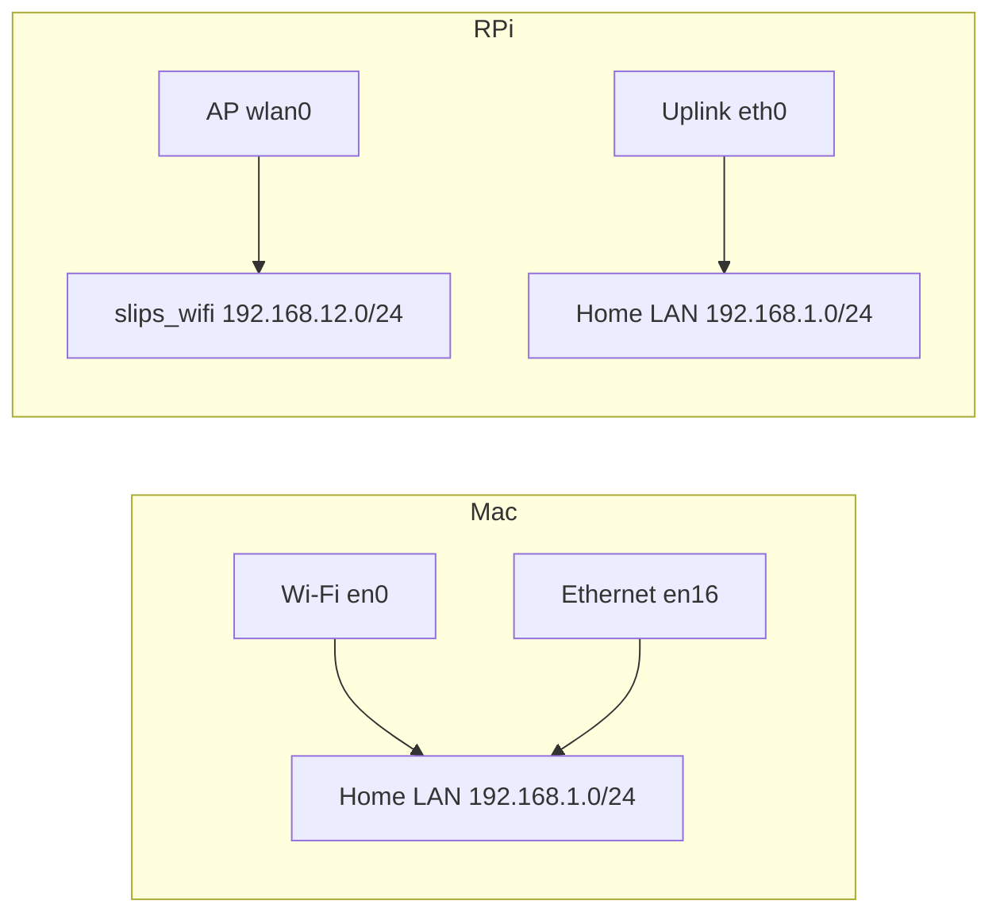

# Multiple interfaces: capture tests and web design

This document records testing of `sebas_testing` at `a8c598af4` on 6 November
2026 and the proposed design for general multi-interface support. The agreed
web default is **All active networks**, with independent network and interface
filters. This is a test report and implementation plan, not a claim that the
general multi-interface capture engine is already implemented. The AP web
support described below was subsequently implemented on this branch.

## Implemented AP web support

The web now reads both AP interfaces, including legacy runs without the
`analysis.interface` field. Its default is **All active networks**, with a
separate **Interface** selector. The header and Overview show both interfaces.
Network and interface filters retain the other investigation filters.

The request scope is a union of interface-specific network histories and
connection sessions. Each interface keeps its own reconnection boundary;
reconnecting one does not reset the other. Evidence, linked alerts, host
findings and traffic use this scope before grouping and pagination. Legacy
evidence can recover its interface from unambiguous linked connection or
protocol records. Unattributable history remains in All retained networks.

Validation includes real Chrome checks in both themes, macOS unit/API
regressions, and Linux/RPi tests. The isolated RPi web check reuses the real
connected-client capture recorded below, rather than simulating client traffic.
It verifies that combined evidence IDs equal the union of the separate Wi-Fi
and Ethernet results and that the Wi-Fi client's saved flows are visible.
The final HTTP check returns 75 hosts and all 28 evidence records for the
active-network union, with 26 evidence records on Ethernet and 2 on Wi-Fi.
Those two Wi-Fi findings are stored whitelist exclusions: the browser shows
them when **Show Whitelisted Evidence** is selected. The Wi-Fi client's 205
stored flows are available independently of that evidence visibility choice.
The real browser check shows both network cards and selectors and opens the
Wi-Fi Hosts and Evidence views without JavaScript errors. Scoped evidence
HTTP queries in this small replay took about 20–50 ms on the RPi; these are
sample timings, not a sustained-load benchmark.

The remaining capture-engine design below still applies: this change does not
introduce general `-i` interface-list syntax, migrate IP-keyed detector state,
or deduplicate forwarded connections. Existing single-interface, saved-view
and archive behavior is retained.

## An interface is not a network

On the tested Mac, `en0` has `192.168.1.100` and `en16` has `192.168.1.136`.
Both have the same `192.168.1.0/24` prefix, router IP and router MAC: two
capture interfaces reaching the same LAN. Their DNS settings differ, so DNS
exceptions still need to be checked against the individual interface.

On `rpi5-2`, Ethernet `eth0` has `192.168.1.170/24`, while Wi-Fi `wlan0`
is an actual AP with SSID `slips_wifi` and address `192.168.12.1/24`.
These are two separate IP networks connected through the RPi.

Do not equate two interfaces with two networks, and do not equate equal
private address ranges with the same network. Separate VPNs, VLANs and LANs
can reuse the same addresses.

## Results so far

| Check | Result |
| --- | --- |
| Normal macOS `-ap en0,en16` launch | Stops because the legacy mode requires a detected access point. |
| macOS legacy capture engine, skipping only the AP-presence check in a test harness | Two independent Zeek processes capture `en0` and `en16`. Both retain their interface in stored flows. |
| Interface-bound HTTP requests | Both interfaces completed HTTP requests with their respective source addresses. |
| Ethernet request visibility in AP mode | Its outbound HTTP connection was absent from the Ethernet log. The AP code deliberately applies `dst net <Ethernet subnet>`, capturing only that direction. |
| macOS stored data at API inspection | 313 hosts, 5 evidence records and 3,468 processed input records. These are a live snapshot, not final capture totals. |
| Same data with `network=current`, before the web fix | Zero hosts and zero evidence records. This reproduced #2186. |
| Three interfaces passed to the legacy AP interface storage function | Rejected with `too many values to unpack (expected 2)` before any database write. |
| General comma-separated `-i en0,en16` validation | Rejected as an invalid interface name; this syntax is not implemented yet. |
| RPi native `-ap wlan0,eth0` capture | Started without a harness or AP override; both capture workers and local networks were recognized. |
| RPi stored observations at API inspection | 326 Ethernet flows and 9 AP flows, with the correct interface tags. An interface-bound HTTP request returned 200 over Ethernet; an mDNS query was emitted and captured on the AP interface. |
| RPi unfiltered web results | 261 hosts and 12 evidence records. |
| RPi web results with `network=current`, before the web fix | Zero hosts and zero evidence records: the same #2186 failure as macOS. |
| RPi Wi-Fi client forwarding | Validated in a second isolated capture with a real client at `192.168.12.76`. Its `example.com` QUIC connection and translated Ethernet response match by protocol, remote endpoint, client port, timing and response byte count. |

The macOS engine exercise used an isolated output, permanent directory, Redis
port `32841` and web port `55160`. P2P, blocking, ARP poisoning, feed updates
and automatic code updates were disabled. A small set of detection modules
was enabled; this was not an exhaustive test of every detector. The normal
`sebas-en0` run remained running. The test capture was stopped gracefully.

Artifacts are under `output/multi-interface-macos-20261106/`: the baseline
console log, test configuration, network snapshots, API responses and flow
summary. No OS network configuration was changed by the macOS harness.

The RPi validation uses a separate temporary container based on its existing
image, updated to the same branch commit. It shares host networking to see
the real AP and uplink, but does not mount the production configuration,
output or permanent directory. It has a separate run database and web port,
limited CPU/RAM, and no blocking or ARP-poisoning modules. The existing Slips
container and AP configuration are retained. Client forwarding is a separate
check from packets generated by the RPi itself.

### Connected-client follow-up

A test device joined `slips_wifi` as `192.168.12.76` and opened
`http://example.com`. Its DNS query to the AP at `192.168.12.1` returned
`104.20.23.154` and `172.66.147.243`. The browser then used QUIC/HTTPS;
the Wi-Fi TLS log records `example.com` as the server name.

| Observation | Wi-Fi `wlan0` | Ethernet `eth0` |
| --- | --- | --- |
| Local endpoint | `192.168.12.76:58403` | `192.168.1.170:58403` after address translation |
| Remote endpoint | `104.20.23.154:443/UDP` | `104.20.23.154:443/UDP` |
| Response payload | 12,361 bytes in 51 packets | 12,361 bytes in 51 packets |
| First observation | Client request | Response about 19 ms later |

The TCP connection to the same server on port 80 carried no application
payload. Consequently, this visit produces no plaintext HTTP request record;
that does not indicate a missing capture. The QUIC connection has traffic in
both directions on Wi-Fi, while Ethernet has only the response direction
because of the existing AP-mode capture filter. These are two observations of
forwarded traffic, not two independent client connections.

At API inspection, the second run had 596 Ethernet flows and 193 Wi-Fi flows,
including 184 stored flows involving the test client. The unfiltered web API
returned 315 hosts and 17 evidence records; adding `network=current` again
returned zero for both. Client forwarding is therefore validated, while the
web scope failure remains unresolved. These counts are live snapshots.
After shutdown, the database passed SQLite integrity checking and retained
981 flows (763 Ethernet, 218 Wi-Fi), 28 evidence records and no alerts. Both
observations of the example.com QUIC connection are present in SQLite with
their correct interface tags. Shutdown reached the existing 30-second module
deadline; the web worker did not report a normal stop. No test capture or web
workers remained afterward, and the test Redis was then stopped separately.

The follow-up uses `output/ap-client-validation-20261106` inside the isolated
container. Its reports and capture archive are retained locally under
`output/multi-interface-macos-20261106/rpi-ap-client/`.

The RPi test capture was stopped gracefully after the measurements, its
private Redis was stopped, and the temporary validation container was stopped.
The original RPi container remained running and `wlan0` remained in AP mode.
The test's report, console log and output archive are copied locally under
`output/multi-interface-macos-20261106/rpi-ap/`.

The RPi evidence snapshot also had three records whose interface was persisted
as `default`, rather than an actual capture interface. Per-flow interface tags
are already useful, but evidence provenance needs an audit across detectors.

The following mapping illustrates the distinction that the web must preserve:

## Original cause of #2186

`MetadataManager` previously wrote `analysis.interface` for `-i`, but not for
`-ap`. AP runs nevertheless recorded both entries in `network_states` and
retained the interface on captured flows. The web reader's current-network
path read `analysis.interface` and built an empty scope when it was missing.
Unfiltered queries returned the captured hosts and evidence.

Several web paths also selected only the first interface from a comma-separated
string. Fixing metadata alone would still have selected one interface's context.
The implementation now uses the selected interface/session union instead.

Other dependencies to address before claiming general support:

- The AP manager stores exactly two named roles, Wi-Fi and Ethernet, and
  parses a display string separated by underscores.
- The local-network handler expects one interface, or two in AP mode.
- Some retention, P2P and startup paths check `-i` rather than live capture
  capability. They need coverage for every supported capture mode.
- Host profiling and substantial detector state are keyed by IP/profile.
  Reused private IPs in concurrent networks must not merge their scores,
  identities or scan counters. A web filter alone cannot fix this.

## Proposed model

| Entity | Meaning |
| --- | --- |
| Capture run | One Slips process tree, shared storage budget and web listener. |
| Capture interface | OS interface, capture status, configured filter and packet/drop statistics. |
| Network | An identified LAN, AP, VPN or other traffic domain, independent of a particular interface. |
| Connection session | One interface's uninterrupted attachment to one network, with start/end times. |
| Observation | A flow/evidence observation carrying its interface, network and connection-session provenance. |

An identified network may have several simultaneous interface attachments.
An interface can change networks over time. Unknown network identity must be
isolated to its interface/session until identified; it must not collapse every
unknown network into a shared run identity.

Identity should use normalized link information and network context, including
VLAN or VPN context where available. Router MAC alone is insufficient for
different subnets behind one router. SSID and subnet alone are insufficient
for identifying a network. For an AP, its BSSID and configured local subnet
are useful even when that interface has no upstream gateway. Preserve existing
network names through an explicit identity migration or alias mapping.

Assign capture/session provenance in the existing input envelope. Keep the
capture/profiler path free of web filtering and per-flow network-history
queries. Network discovery updates a cached interface-to-session mapping;
detectors use that carried context when keying state. Persist the provenance
with indexed columns so web queries do not scan JSON across the database.

## Web behavior

1. **Header:** show the run and all active networks. Examples: `Home-Wifi6 ·
   en0, en16` on the Mac, or separate `slips_wifi · wlan0 · AP` and
   `Home-Wifi6 · eth0 · uplink` entries on the RPi. Each shows its own local
   addresses, connection status and last change. A disconnected interface
   remains visible with its capture status.
2. **Network filter:** default to **All active networks**, with named networks
   available individually. Keep the interface filter separate: **All
   interfaces** or a selected interface. Neither selection resets severity,
   grouping, review, search or time filters.
3. **This connection:** for All active networks, use the union of the current
   session on each selected interface. Each session has its own start time;
   do not use a single earliest/latest timestamp for every network. The same
   rule applies to Alerts, Evidence, Hosts, P2P and the P2P graph.
4. **Overview:** one card per selected network, with capture health per
   interface and an aggregate summary. Throughput must distinguish observed
   flows from any validated deduplicated connection total.
5. **Tables:** add a compact Network column when the selected scope includes
   multiple networks. Keep Interface in the observation/details view and
   available as a filter. A host IP reused on two networks has distinct host
   entries and investigation contexts. Keep navigation tabs free of totals.
6. **Investigation:** retain network/session context when following an IP,
   opening triggering flows, and navigating Back. Opening `192.168.1.1` must
   not choose an unrelated network's host with that address.
7. **P2P:** associate peer membership, reports, catch-up and trust comparisons
   with their network. Do not replay one network's private-IP reports into
   another network simply because addresses match. The graph should expose
   network grouping/filtering and retain its existing peer/IP labels.

The server should return the interface/network/session inventory explicitly.
Data endpoints should accept validated network IDs and interface selections,
then apply both scope and time constraints before aggregation and pagination.
The old single-interface query behavior should remain compatible. Missing
provenance in retained history belongs in an explicit unknown-history scope,
not silently inside a current connection.

## Capture and detector correctness

General multi-interface capture needs a dedicated interface-list syntax, for
example `--interfaces en0,en16,utun0`, without an AP requirement or a hidden
Ethernet-direction filter. Preserve `-ap wlan0,eth0` as an explicit legacy
AP policy until its forwarding/deduplication behavior has dedicated tests.
Validate names, duplicates and unsupported combinations before starting
workers. Do not infer interface names by splitting the output display name.

First preserve every observation's origin. A forwarded connection may appear
on both AP and uplink, with address translation changing its tuple. Do not
deduplicate solely by IP/port/time or silently double its detection score.
Correlation across a bridge/router should be explicit, and the UI should
distinguish observations from correlated connections.

Firewall and ARP actions require the exact target network/interface; subnet
membership alone cannot choose safely between overlapping networks. Official
DNS exceptions likewise belong to an interface, service port and session.
Retention must enforce the existing overall run budget, not allocate that
budget once per interface. Queue and worker limits must account for aggregate
traffic and expose capture loss or saturation per interface.

## Implementation order and acceptance checks

1. Retain the completed AP capture-engine and connected-client forwarding
   validations, including their scoped/unfiltered results, as regression cases.
2. Add a normalized general interface list and propagate it to metadata,
   capture setup, host IPs, localnets, lifecycle and retention. Preserve
   single-interface and explicit AP behavior.
3. Make observation, profile and detector state network-aware. Test two
   concurrent networks with the same private addresses before enabling
   combined detections or actions.
4. Add indexed scope queries and the network/interface inventory API. Replace
   first-interface selection with an explicit selection or active-session
   union; test API totals and pagination against stored records.
5. Build the header and independent selectors with All active networks as the
   default. Apply the same selected scope to every page and navigation link.

Acceptance coverage must include macOS Wi-Fi + Ethernet on the same LAN, an
actual RPi AP + uplink, three interfaces, overlapping private address ranges,
VPNs, one interface disconnecting/reconnecting while another stays connected,
failed capture startup, restarts/history, old data without provenance and
bounded storage under sustained aggregate load. Repeat the real connected-client
forwarding check after capture-policy changes; host-generated traffic alone
does not establish that result.
