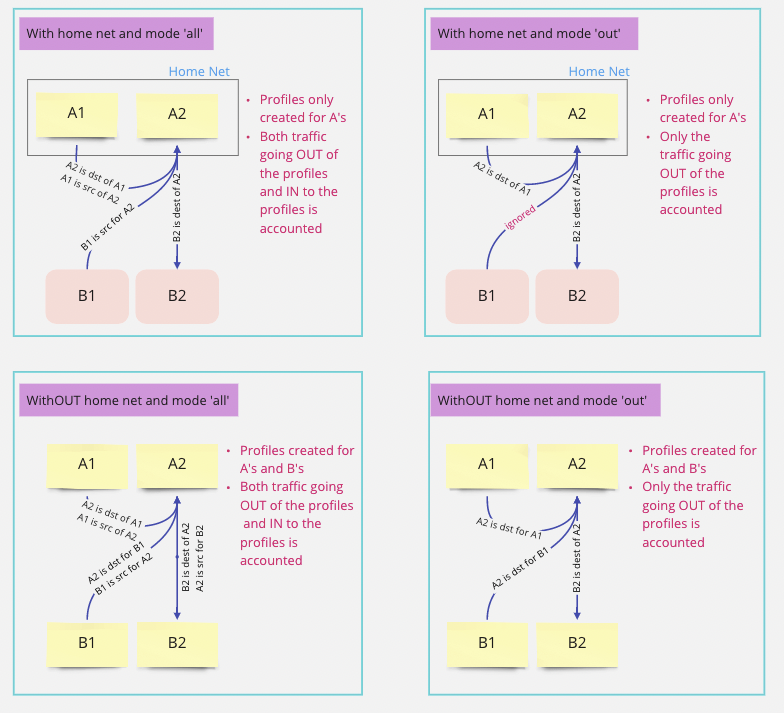

# Usage

## Table of contents

- [Reading the input](#reading-the-input)
- [Daemonized vs interactive mode](#daemonized-vs-interactive-mode)
  - [Running Slips as a daemon](#running-slips-as-a-daemon)
  - [Find, stop and restart running instances](#find-stop-and-restart-running-instances)
- [Running Several slips instances](#running-several-slips-instances)
  - [Analyze a PCAP while a live capture is running](#analyze-a-pcap-while-a-live-capture-is-running)
  - [Keep detections across a live-interface restart](#keep-detections-across-a-live-interface-restart)
- [Reading the output](#reading-the-output)
  - [The Web Interface](#the-web-interface)
- [Saving the database](#saving-the-database)
- [Whitelisting](#whitelisting)
  - [Flows Whitelist](#flows-whitelist)
  - [Blocking Whitelist](#blocking-whitelist)
  - [Alerts Whitelist](#alerts-whitelist)
  - [Tranco whitelist](#tranco-whitelist)
  - [Whitelisting Example](#whitelisting-example)
  - [Whitelist columns](#whitelist-columns)
- [Popup notifications](#popup-notifications)
- [Slips permissions](#slips-permissions)
- [Modifying the configuration file](#modifying-the-configuration-file)
  - [Generic configuration](#generic-configuration)
  - [Disabling a module](#disabling-a-module)
  - [ML Detection](#ml-detection)
  - [Blocking](#blocking)
  - [VirusTotal](#virustotal)
  - [Exporting Alerts](#exporting-alerts)
- [Logging](#logging)
- [Reading Input from stdin](#reading-input-from-stdin)
- [Slips as an access point](#slips-as-an-access-point)
- [Plug in a zeek script](#plug-in-a-zeek-script)
- [Exporting strato letters](#exporting-strato-letters)
- [Slips parameters](#slips-parameters)
- [Disk and RAM usage on long runs](#disk-and-ram-usage-on-long-runs)
- [Limiting Slips resource consumption](#limiting-slips-resource-consumption)

Slips reads traffic from a **network interface**, or from these files:

- Pcap files (internally using Zeek)
- Packets directly from an interface (internally using Zeek)
- Suricata flows (from JSON files created by Suricata, such as eve.json)
- Argus flows (CSV file separated by commas or TABs)
- Zeek/Bro flows from a Zeek folder with log files
- Nfdump flows from a binary nfdump file
- Text flows from stdin in zeek, argus or suricata form

It's recommended to use PCAPs.

All the input flows are converted to an internal format. So once read, Slips works the same with all of them.

- View results in the web interface.
- Optional: the Kalipso terminal interface (install the `modules/kalipso` submodule separately).
- The commands below work the same in [Docker](https://stratospherelinuxips.readthedocs.io/en/develop/installation.html#slips-in-docker) and [native installs](https://stratospherelinuxips.readthedocs.io/en/develop/installation.html#installing-slips-natively).


## Reading the input

The table below shows the different parameter Slips uses for different inputs.


<style>
table {
  font-family: arial, sans-serif;
  border-collapse: collapse;
  width: 100%;
}

td, th {
  border: 1px solid #dddddd;
  text-align: left;
  padding: 8px;
}

tr:nth-child(even) {
  background-color: #dddddd;
}
</style>


<table>
	<tr>
		<th>File/interface</th>
		<th>Argument</th>
		<th>Example command</th>
	</tr>
	<tr>
		<td>Network interface (*)</td>
		<td>-i</td>
		<td>./slips.py -i en0</td>
	</tr>
	<tr>
		<td>pcap</td>
		<td>-f</td>
		<td>./slips.py -f test.pcap</td>
	</tr>
	<tr>
		<td>Argus binetflow</td>
		<td>-f</td>
		<td>./slips.py -f test.binetflow</td>
	</tr>
	<tr>
		<td>Zeek/Bro folder/log</td>
		<td>-f</td>
		<td>./slips.py -f zeek_files</td>
	</tr>
	<tr>
		<td>Nfdump flow</td>
		<td>-f</td>
		<td>./slips.py -f test.nfdump </td>
	</tr>
    <tr>
		<td>Suricata flows</td>
		<td>-f</td>
		<td>./slips.py -f suricata.json </td>
	</tr>
    <tr>
		<td>stdin</td>
		<td>-f</td>
		<td>./slips.py -f zeek </td>
	</tr>
    <tr>
		<td>Access Point</td>
		<td>-ap</td>
		<td>./slips.py -ap wifi_interface,eth_interface </td>
	</tr>

</table>

(*) To find the interface in Linux, you can use the command ```ifconfig```.

- Settings live in `config/slips.yaml`.
- See [Modifying the configuration file](#modifying-the-configuration-file).

## Daemonized vs interactive mode

Slips can run in two modes:

| Mode | How to start it | What happens |
| --- | --- | --- |
| **Interactive** (default) | `./slips.py -i eth0` | Slips stays in your terminal. Press Ctrl-C to stop it. |
| **Daemon** | `./slips.py -i eth0 -D` | Slips runs in the background and gives you your terminal back. |

- Slips runs in interactive by default, if you're unsure, use the default.
- Output files go to a dir created and printed to your CLI when you run slips e.g `output/<some_dir>`
- You can pass `-o` to override the default generated output dir.
- By default you don't need root to run Slips. If you point the output directory
to a folder owned by root, run Slips with sudo or give your user write access
to that folder.

### Running Slips as a daemon

```bash
./slips.py -i eth0 -o output/my-network -w -D
```

What to expect:

- **Startup:** waits up to 30 seconds, then prints the daemon PID and log file.
- **Startup errors:** printed in your terminal.
- **Follow progress:** `tail -f output/my-network/slips.log`. The line `Slips daemon core workers started` means Slips is up.
- **Logs:** `slips.log` (messages) and `errors.log` (errors) in the output folder. Old logs are kept.
- **One daemon at a time.** Normal runs can still run next to it.
- **PID file:** `permanent/slips_daemon.lock`. No sudo needed for it.

### Find, stop and restart running instances

Run these from the Slips folder, using the same Python environment you used to
start Slips:

| Command | What it does |
| --- | --- |
| `./slips.py --list-instances` | Shows every running Slips instance started from this folder. |
| `./slips.py --stop` | Stops Slips if only one instance is running. |
| `./slips.py --stop 12345` | Stops the instance with PID `12345`. |
| `./slips.py --stop all` | Stops every running instance from this folder. |
| `./slips.py --restart` | Restarts the running daemon. |
| `./slips.py --restart 12345` | Restarts the daemon with PID `12345`. |

- These commands work alone.
- Don't combine them with `-i`, `-f`, `-c` or other analysis options.

#### Listing instances

`--list-instances` shows each instance's PID, how it was started, web port, input and output folder.

- Finds daemons, terminal runs, and runs started with `&` or `nohup`.
- Skips Slips' internal workers and runs from other Slips folders.
- A `-` in **WEB PORT** means no web interface was found.
- Read-only: starts nothing and touches no database.

#### Stopping

- If several instances run, `--stop` lists them and asks for a PID.
- Same as pressing Ctrl-C: Slips saves its data and shuts down cleanly.
- Waits up to 45 seconds. If something is still running, it prints the PIDs and exits with an error (no force-kill). Check `errors.log`.
- Stopping a PCAP run early skips the rest of the PCAP.
- Saved history and alerts are never deleted.
- `-S`/`--stopdaemon` is now `--stop`.

#### Restarting

- `--restart` stops the daemon, then starts it again with the same command and folder.
- Daemons only. It can't restart interactive runs or stopped daemons.
- Waits up to 5 minutes for saving, with progress every 10 seconds. If stopping fails, nothing new starts.
- Config files are read again, so config changes apply.
- Your options (`-i`, `-o`, `-c`, `-w`, `--web-port`, `--keep-history`) are kept as they were.

On macOS, use the Python from your virtual environment, for example:

```bash
.venv-macos/bin/python slips.py --restart
```

## Running Several slips instances

Each Slips run needs Redis. By default Slips starts and uses Redis on port 6379:

| Redis database | What it holds | Shared between runs? | Cleared on startup? |
| --- | --- | --- | --- |
| Port 6379, DB 0 | The current run's profiles, time windows and alerts | No | Yes (set `deletePrevdb: false` to skip) |
| Port 6379, DB 1 | Cache, such as threat intelligence | Yes, by all runs | No |

- Use `-m` to run several instances at once.
- Each one gets its own Redis port from 32768 to 32850, or pick one with `-P <port>`.

| How Slips runs | Redis port for DB 0 |
| --- | --- |
| Live traffic (`-i`, `-g`) or any run without `-m` | 6379 |
| `-m` (for example `-m -f file.pcap`) | First free port from 32768 to 32850 |
| `-P <port>` | The port you give |

- All instances share the cache (port 6379, DB 1).
- Output goes to `output/<filename>_<timestamp>/`.

- Slips starts the Redis servers it needs automatically.
- On macOS, you may get a popup asking to allow the new port. Click **Allow**.
- Running Slips twice on the same input creates a new output folder each time.
- Each web interface only shows the run that started it. If you use `-w` on
  several runs, give each one its own `--web-port`.
- When you are done, close the Redis servers Slips started with
  `./slips.py --killall`.

### Analyze a PCAP while a live capture is running

- Analyze a PCAP (or a finished Zeek folder) without disturbing a running live capture.
- Use `-m`, `-f` and `-o` together:

```bash
nice -n 15 ./slips.py -m -w \
  -c config/slips.yaml \
  --web-port 55002 \
  -f dataset/test7-malicious.pcap -o output/pcap-analysis-01
```

- Use `-c` with your normal config. No need to copy or edit it.
- Pick a web port the live capture doesn't use, then open `http://127.0.0.1:55002/`.
- Use a new `-o` folder for each analysis. Reusing one replaces the old analysis.
- `nice` gives the live capture CPU priority. It doesn't limit memory, so on low-RAM machines analyze PCAPs elsewhere.
- When it finishes, answer `n` (or press Enter) to keep the web interface open. Keep that terminal open.
- Don't use `--keep-history`, `--clearcache` or `-P 6379` here. Slips refuses them.

Slips keeps this analysis separate from the live one automatically:

| What | Live capture | PCAP analysis |
| --- | --- | --- |
| Redis | Port 6379, DB 0 | Its own Redis port (32768-32850) |
| Host identity DB | `permanent/host_profiles/hosts.sqlite` | `<output>/host_profiles/hosts.sqlite` |
| Regex generator store | `permanent/databases/regex_store/` | `<output>/regex_generator/` |
| T Cell store | `<output>/t_cell/` (or `permanent/` if you set `persistent_store_dir`) | `<output>/t_cell/` |
| Threat intelligence feed downloads | `permanent/remote_data_files/` | The same folder |
| Whitelist | Your whitelist | The same whitelist (a copy is kept in `<output>/metadata/`) |
| Redis and web passwords | Yours | The same files in `permanent/`, so the same login works |
| Zeek files | As configured | Kept inside the analysis output |
| Web interface | As configured | Only reachable from this machine (localhost) |
| Automatic Slips updates | As configured | Turned off |
| Threat intelligence cache | Port 6379, DB 1 | Shared with the live capture |

- Your config file is never changed.
- The **Configuration** tab in the web interface shows the settings the analysis used.

To open the web interface of a remote machine, forward the port over SSH from
your own computer:

```bash
ssh -N -L 127.0.0.1:55002:127.0.0.1:55002 user@remote-host
```

### Keep detections across a live-interface restart

Use `--keep-history` with the same interface and output folder every time you
start Slips:

```bash
./slips.py -i eth0 -o output/my-network --keep-history -w
```

- **First start:** no `databases/flows.sqlite` yet? Slips starts fresh. No setup needed.
- **Later starts:** old alerts, evidence and web history are kept.
- Temporary Redis DB 0 data is cleared. The shared cache (DB 1) is kept.
- Stop the previous run first. Slips refuses two runs with the same output folder or web port.
- Not allowed with `-m` or a `-P` port other than 6379. A separate PCAP analysis can still run beside it.
- For a clean start, run without `--keep-history`.

- Slips doesn't keep everything forever. Old flows, alerts and logs are removed or archived.
- Limits and how to change them: [How Slips forgets the past](data_retention.md).


- Each run uses a free Redis port from 32768 to 32850.
- If more than one Redis server is open, Slips warns you:

```text
[Main] Warning: You have 2 redis servers running. Run Slips with --killall to stop them.
```

- Close them with:

```bash
./slips.py -k
```

- Then choose what to close:

```text
Choose which one to kill [0,1,2 etc..]

[0] Close all servers
[1] dataset/sample_zeek_files - port 32768
[2] dataset/sample_zeek_files - port 32769
[3] dataset/sample_zeek_files - port 32770
```

- Type a number, or `0` to close all servers.
- If every port from 32768 to 32850 is used, Slips can't start and shows:

```text
All ports from 32768 to 32769 are used. Unable to start slips.

Press Enter to close all ports.
```

- Press Enter to close all ports, then start Slips again.


- `-g` runs Slips on a growing Zeek directory. It was added because running Slips on an interface has issues on macOS.
- Run Slips in Docker and mount a Zeek folder into the container.
- Start Zeek inside the container:

```bash
bro -C -i <interface> tcp_inactivity_timeout=60mins tcp_attempt_delay=1min <path_to>/slips/zeek-scripts
```

- Start Slips on that folder:

```bash
./slips.py -e 1 -g <zeek_dir> -i <interface>
```

- Slips treats the folder like one made by `-i` and keeps waiting for flows until you stop it.
- **Required:** pass `-i` with the same interface Zeek is monitoring.


## Reading the output

Where to find Slips' results:

- **alerts.json and alerts.txt** (output folder): all evidence and detections, as text and JSON.
- **`output/alerts/alerts_summary.log`**: one short summary per alert. Needs the `alert_summary` module.
- **`llm-summary/alert_summary.log`** (output folder): logs of how those summaries were made. Needs the `alert_summary` module. Detail level: `alert_summary.log_verbosity`.
- **`LLM/llm.log`** (output folder): logs of LLM requests and responses. Needs the `LLM` module.
- **Log folder named _current-date-time_**: traffic split by profile and time window, with a summary of each.
- **Web interface** - browser based GUI for viewing slips detections, incoming and outgoing traffic, and an organized timeline of flows.


### The Web Interface

Enable the run-specific local interface with `-w`:

```bash
./slips.py -e 1 -f dataset/test7-malicious.pcap -w
```

- Open `http://localhost:55000/`.
- Or enable it in `config/slips.yaml` with `web_interface.enabled: true`. The port is `web_interface.port`.
- Tabs: Overview, Alerts, Evidence and Hosts, with search, sorting and filters.
- You can click from an alert to its evidence to its flows.
- More details: [Local web interface](web_interface.md).
- Docker on Linux: use `--net=host`. The web interface only listens on localhost, so normal port publishing can't reach it.

## Saving the database

You can save slips analysis and load it again if you want to view the analysis details later.

**Saving**

- Slips saves the database automatically when an analysis ends.
- Location: `<output_dir>/databases/dump.rdb`.
- If the web interface is running, Slips keeps Redis open instead of saving.

**Loading**

```bash
sudo ./slips.py -d output/<run>/databases/dump.rdb
```

- Replace the path with your saved `.rdb` file.
- `-d` cannot be combined with other input flags (`-f`, `-i`, ...).
- The web interface cannot upload, browse or switch saved databases. Loading is done only with `-d`.

**Limits**

- Loading needs **root** and is only supported on Linux.
- Not supported in Docker because of Redis problems inside containers.


## Whitelisting

- Whitelist what you don't want Slips to process: an IP, a domain, a MAC address, or a whole organization.
- Choose the direction: traffic **to** them, **from** them, or both.
- Choose what to skip: **flows** (not processed) or **alerts** (flows still shown, no alerts).
- It skips communication to or from these items, not every packet that mentions them.
- Example: whitelisting `slack.com` still shows a DNS request to 1.2.3.4 asking for `slack.com`.


- Turn the whitelist on or off with `enable_local_whitelist` in `config/slips.yaml`.

- On a live interface, Slips ignores its own lookup connections (update checks, `whois`, public-IP lookups).
- This applies only to the current run, not to imported captures.

- Don't edit the default `config/whitelist.conf`. Copy it, edit your copy, and set `whitelists.local_whitelist_path` in your Slips config.

Example:

```bash
cp config/whitelist.conf config/my_whitelist.conf
cp config/slips.yaml config/my_slips.yaml
```

Then set ```local_whitelist_path: config/my_whitelist.conf``` in ```config/my_slips.yaml``` and run Slips with:

```bash
./slips.py -c config/my_slips.yaml -f dataset/test7-malicious.pcap
```

- The attacker and victim of every evidence are checked, plus their related IPs, DNS resolutions, SNI and CNAMEs.
- If any of them is whitelisted, the flow or evidence is discarded.
- Whitelists use bloom filters to make checks fast.

### Flows Whitelist
If you whitelist an IP address, Slips will check all flows and see if you are whitelisting to them or from them.

If you whitelist a domain, Slips will check:
- Domains in HTTP Host header
- Domains in the SNI field of TLS flows
- All the Domains in the DNS resolution of IPs (there can be many) (be careful that the resolution takes time, which means that some flows may not be whitelisted because Slips doesn't know they belong to a domain).
- Domains in the CN of the certificates in TLS

If you whitelist an organization, then:
- Every IP is checked against all the known IP ranges of that organization
- Every domain (SNI/HTTP Host/IP Resolution/TLS CN certs) is checked against all the known domains of that organization
- ASNs of every IP are verified against the known ASN of that organization

If you whitelist a MAC address, then:
- The source and destination MAC addresses of all flows are checked against the whitelisted mac address.


### Blocking Whitelist

To keep flows, evidence and alerts while preventing firewall blocking and ARP
poisoning, put this rule in your copied whitelist file:

```csv
ip,192.168.1.128,both,blocking
```

### Alerts Whitelist

To suppress one evidence type only when a specific source IP connects to a
specific **destination port**, add this line to your copied whitelist file:

```csv
ip,192.168.1.163->*:902,src,alerts,UNKNOWN_PORT
```

- All three must match: source `192.168.1.163`, destination port `902`, evidence type `UNKNOWN_PORT`.
- `*` means any destination IP. The source port can be anything.
- Other sources, ports and evidence types can still alert.
- Flows are still processed. Matching future evidence is left out of alert scoring. Old evidence and alerts are not removed.
- IPv6 source: `[2001:db8::10]->*:902`.
- The source must be one IP. The port must be 1 to 65535. Needs `src,alerts`. ICMP can't match (no ports).
- Leave out the fifth column to cover every evidence type.
- The source must be recorded in the evidence, not inferred from a domain.
- Not the same as `ip,192.168.1.163:902,src,alerts,UNKNOWN_PORT`, which matches **source port** 902.
- Restart Slips once after upgrading. After that, edits refresh normally. The web editor supports this too.

If you whitelist some piece of data not to generate alerts, the process is the following:

- If you whitelisted an IP
    - We check if the source or destination IP of the flow that generated that alert is whitelisted.
    - We check if the content of the alert is related to the IP that is whitelisted.

- If you whitelisted a domain
    - We check if any domain in alerts related to DNS/HTTP Host/SNI is whitelisted.
    - We check also if any domain in the traffic is a subdomain of your whitelisted domain. So if you whitelist 'test.com', we also match 'one.test.com'

- If you whitelisted an organization
    - We check that the ASN of the IP in the alert belongs to that organization.
    - We check that the range of the IP in the alert belongs to that organization.

- If you whitelist a MAC address, then:
  - The source and destination MAC addresses of all flows are checked against the whitelisted mac address.

### Tranco whitelist

- Slips uses the [Tranco list](https://tranco-list.eu/) (a top-sites ranking that is hard to manipulate) to reduce false alerts.
- It downloads the top 10k domains and, by default, whitelists their evidence and alerts. Flows are still shown.
- The list is updated daily. Change this with `online_whitelist_update_period` in `config/slips.yaml`.
- Turn it on or off with `enable_online_whitelist`.
- Storage: kept in Redis as `tranco_whitelisted_domains`, in download order. Other modules, such as `RegexGenerator`, read the first `whitelists.tranco_top_benign_limit` entries.

### Whitelisting Example
- Don't edit `config/whitelist.conf`. Copy it, point `local_whitelist_path` in your copied config to the copy, and edit that.
- Your copied whitelist can contain:

    "IoCType","IoCValue","Direction","IgnoreType","EvidenceType"
    ip,1.2.3.4,both,alerts
    ip,192.168.1.163:5353,dst,alerts
    ip,[fe80::1]:5353,dst,alerts
    ip,192.168.1.10->*:902,src,alerts,UNKNOWN_PORT
    ip,192.168.1.128,both,blocking
    domain,google.com,src,flows
    domain,apple.com,both,both
    ip,94.23.253.72,both,alerts
    ip,91.121.83.118,both,alerts
    mac,b1:b1:b1:c1:c2:c3,both,alerts
    organization,microsoft,both,both
    organization,facebook,both,both
    organization,google,both,both
    organization,apple,both,both
    organization,twitter,both,both
    uri,/health,both,flows

### Whitelist columns

Write one rule per line, with four required columns and an optional fifth:

```text
IoCType,IoCValue,Direction,IgnoreType,EvidenceType
```

- Separate columns with commas. Don't quote values.
- Use lowercase for type, direction and mode.
- Lines starting with `;` are comments.
- Start a rule with `#` to disable it.
- Don't put a comment after a rule on the same line.

| Column | What it does and why |
| --- | --- |
| `IoCType` | What to match: `ip`, `domain`, `organization`, `mac` or `uri`. |
| `IoCValue` | The address, name or path, such as `192.168.1.10`, `example.com`, `apple`, `a1:a2:a3:a4:a5:a6` or `/health`. IPs can include a port (see below). |
| `Direction` | `src`, `dst` or `both`. This is the role in the flow or evidence. An attacker is not always the source. |
| `IgnoreType` | What to skip. See the modes below. |
| `EvidenceType` (optional) | Limits an `ip` rule with mode `alerts` to one detection, such as `UNKNOWN_PORT` or `ARP_SCAN`. Use the internal name from `slips_files/core/structures/evidence.py`. Leave empty for all types. Not supported for other types or modes. |

The four `IgnoreType` modes have different effects:

| Mode | Effect |
| --- | --- |
| `alerts` | Flows are still processed. Matching evidence is left out of scoring and alerts. Use **Show excluded** in the web interface to see it. |
| `flows` | Matching flows are skipped before detection, so they can't produce detections. Use `alerts` to keep analyzing them. |
| `both` | Skip matching flows and leave matching evidence out of scoring and alerts. |
| `blocking` | Keep everything, but never block or ARP-poison that IP. Needs one IP, `Direction=both`, and no port or evidence type. |

Supported values and their limits:

- **IP address:** one IPv4 or IPv6 address, on every port. No subnets or ranges (like `192.168.1.0/24`).
- **IP and its port:** `192.168.1.10:902` or `[2001:db8::10]:902`. Address and port must match on the same side. `src` means source port, `dst` means destination port.
- **Any IP on a port:** `*:902` matches that port on the chosen side. One port number (0 to 65535, no leading zeros), no TCP/UDP choice. Use one line per port.
- **Source IP to a destination port:** `192.168.1.10->*:902`. Needs `src,alerts` and a port from 1 to 65535. ICMP can't match. The evidence must record the source IP and destination port.
- **Domain:** a domain and its subdomains, with no `https://` or path. Slips must know the domain from DNS or protocol data.
- **Organization:** `google`, `microsoft`, `apple`, `facebook` or `twitter`.
- **MAC address:** six pairs separated by colons. Slips must have recorded the host's MAC.
- **URI:** an exact HTTP request path (with the query string, if any). Max 256 characters, no commas.
  - `/health` does not match `/health?check=1`. It is not a prefix or regex.
  - Use `both,flows` or `both,both`.
  - Direction and IP/port are ignored.

This rule keeps flows but leaves out only `UNKNOWN_PORT` evidence for one source connecting to destination port 902:

```text
ip,192.168.1.10->*:902,src,alerts,UNKNOWN_PORT
```

- All conditions on the line must match.
- Other whitelist rules still apply, so a broader rule can still suppress the same traffic.
- For the same type, value and evidence type, the last rule wins.
- Adding a rule does not delete old evidence or alerts.

## Popup notifications

- Slips can show a desktop notification when a host crosses the alert threshold.
- It shows the host IP and name, the latest finding, and the host score. Details stay in the web interface.
- Off by default. Turn it on with `popup_alerts: yes` in `config/slips.yaml`.
- Linux: supported, needs root.
- Docker: not supported.
- macOS: no root needed.
  - Slips builds a small **Slips** notification app in `~/Applications/Slips Notifications.app`. It needs Apple's developer tools (`swiftc`, `sips`, `codesign`).
  - Allow notifications for **Slips** in **System Settings → Notifications**. Check Focus settings if banners are hidden.
  - If the app can't be built, Slips falls back to `osascript`. That uses Script Editor's permission and icon.
- Restart Slips after enabling `popup_alerts` or updating the notification code.

## Slips permissions

Slips doesn't need root permissions unless you

1. use the blocking modules (Firewall and ARP poisoner) ( with -p )
2. load a saved database ( with -d )

- To let any user (not only root) capture with Zeek, run:

```
sudo setcap cap_net_raw,cap_net_admin=eip /<path-to-zeek-bin/zeek
```

- Even with sudo, Slips drops root in modules that don't need it.


## Modifying the configuration file

- `config/slips.yaml` holds Slips' settings. Below are some you can change.
- Don't edit the default file. Copy it and run Slips with your copy using `-c`.

Example:

```bash
cp config/slips.yaml config/my_slips.yaml
./slips.py -c config/my_slips.yaml -f dataset/test7-malicious.pcap
```

### Generic configuration

**Time window width.**

- Each IP in the traffic gets a profile, split into time windows.
- Default window: 1 hour. Change it with `time_window_width` in `config/slips.yaml`.


**Analysis Direction**

- `analysis_direction` is `out` or `all`.
- It controls which traffic Slips analyzes.
- `all`: both inbound traffic (incoming attacks) and outbound traffic (data exfiltration).
- `out`: only traffic from internal hosts (A) to external hosts (B).
- Both modes create profiles for internal and external IPs.

**Persistent runtime data**

- `permanent_dir` sets where data that must survive between runs is stored.
- This includes `p2p_trust_runtime/`, `databases/regex_store/`, and shared databases such as the Fides cache under `databases/`.

**Live Slips auto update**

- `update.auto_update_slips` turns live Slips updates on or off:

```yaml
update:
  auto_update_slips: false
```

- This is separate from `feeds_update_manager`, which only updates TI feeds.
- If a TI feed returns an empty reply, Slips keeps the last valid entries and logs the skip in `slips.log`. A later nonempty version loads at the next check.
- Invalid entries are skipped and logged. The rest of the feed still loads.
- Automatic updates may overwrite the default config files. Use your own config copies to keep your changes.

- Choose the update channel with `update.channel_to_update_slips_from`:

- ```stable``` -> ```origin/master```
- ```unstable``` -> ```origin/develop```
- ```testing``` -> uses the branch specified in ```update.testing_branch_to_update_slips_from```


<div class="zoom">

</div>


### Disabling a module

- Disable a module by adding its name to the `disable` list.
- Use the module's folder name inside `modules/`.

### ML Detection

- `mode=train`: all received flows are used for training.
- `mode=test`: use after training, to test unknown data.
- Train at least once with Normal data and once with Malicious data before testing.

### Blocking

- Enabled only with `-p`. Needs an interface.
- Needs root, so Slips can run iptables commands:

```bash
sudo ./slips.py -i wlp3s0 -p
```

- In Docker there is no root, so set `IS_IN_A_DOCKER_CONTAINER=True` to use `sudo` properly.
- The latest Dockerfile sets it. Otherwise, run this in the container:

```bash
export IS_IN_A_DOCKER_CONTAINER=True
```


### VirusTotal

- Put your VirusTotal API key in `config/vt_api_key`.
- To use another path, set `api_key_file`.
- The file holds only the key, at the start of the first line.
- No key means the virustotal module won't start.


### Exporting Alerts

Slips can export alerts to different systems.

Refer to the [exporting section of the docs](https://stratospherelinuxips.readthedocs.io/en/develop/exporting.html) for detailed instructions on how to export.


## Logging

To enable the creation of log files, there are two options:

1. Running Slips with ```verbose``` and ```debug``` flags
2. Using errors.log and running.log

#### Zeek log files

- `delete_zeek_files` (yes/no): delete Zeek logs when Slips stops.
- Zeek logs grow to GBs. On an interface, Slips deletes them after 1 day (**rotation**, on by default).
- Turn rotation off with `rotation: no` in `config/slips.yaml`. See [rotation](https://stratospherelinuxips.readthedocs.io/en/develop/usage.html#rotation).
- `store_a_copy_of_zeek_files: yes`: keep a copy in `<output_dir>/zeek_files/` when Slips stops. Logs already deleted aren't included.
- `store_zeek_files_in_the_output_dir: yes`: store logs while Zeek is still writing them.
- If both are on, shutdown keeps the logs already in the output folder.
- If you don't want a copy (`delete_zeek_files` on, `store_a_copy_of_zeek_files` off), large logs such as `arp.log` are deleted periodically.


#### Rotation of zeek logs

- Rotation stops Zeek logs from growing and saves disk space. It only runs on an interface.
- Default: every 1 day. Change it with `rotation_period` in `config/slips.yaml`.
- Format: a number plus a unit: `usec`, `msec`, `sec`, `min`, `hr` or `day`. A space and a plural `s` are optional. See [Zeek rotation interval](https://docs.zeek.org/en/master/script-reference/types.html#type-interval).
- `keep_rotated_files_for`: keep rotated files for this many days before deleting them. Days only.


####  Running Slips with verbose and debug flags

- Two settings, `verbose` and `debug`, each from 0 to 3.
- `verbose` (default 1): how much Slips tells you about its normal work. Example: "Done writing logs to file x."
- `debug` (default 0): errors only, so none are printed by default. Example: "Error reading threat intelligence file, line 4, column 2"
- Higher number, more detail.
- Set them with `-v` and `-e`:

```bash
./slips.py -c config/slips.yaml -v 2 -e 1 -f zeek_dir
```

The levels are below.

Below is a table showing each level of both.

<table>
<tbody>
<tr style="height: 22px;">
<td style="height: 22px;">&nbsp;</td>
<td style="height: 22px;">&nbsp;Verbosity</td>
<td style="height: 22px;">&nbsp;Debugging</td>
</tr>
<tr style="height: 22px;">
<td style="height: 22px;">&nbsp;0</td>
<td style="height: 22px;">&nbsp;Don't&nbsp;print</td>
<td style="height: 22px;">&nbsp;Don't print</td>
</tr>
<tr style="height: 22px;">
<td style="height: 22px;">1&nbsp;</td>
<td style="height: 22px;">&nbsp;Show basic operation, proof of work&nbsp;</td>
<td style="height: 22px;">&nbsp;Print exceptions</td>
</tr>
<tr style="height: 22px;">
<td style="height: 22px;">2&nbsp;</td>
<td style="height: 22px;">&nbsp;Log I/O operations and filenames</td>
<td style="height: 22px;">&nbsp;Unsupported and unhandled types (cases that may cause errors)</td>
</tr>
<tr style="height: 22px;">
<td style="height: 22px;">3&nbsp;</td>
<td style="height: 22px;">&nbsp;Log database/profile/timewindow changes</td>
<td style="height: 22px;">&nbsp;Red warnings that need examination - developer warnings</td>
</tr>
</tbody>
</table>

#### Using errors.log and running.log

- `errors.log`: errors, in the output folder. Written in interactive and daemon mode, with or without `-e`. See [Daemonized vs interactive](https://stratospherelinuxips.readthedocs.io/en/develop/usage.html#daemonized-vs-interactive-mode).
- `slips.log`: general messages, in the same folder.
- You can rename both in the `output` config section.

## Reading Input from stdin

- Slips can read text flows from stdin, in interactive mode only.
- Supported: Zeek conn.log (JSON), Suricata and Argus.
- Start Slips with:

```bash
./slips.py -f zeek
```

or

```bash
./slips.py -f suricata
```

- When you see `[InputProcess] Receiving flows from stdin.`, start sending flows.
- Zeek lines must be JSON. They are treated as conn.log lines.
- Made for network simulators and scripts.


## Slips as an access point

- Slips can monitor two interfaces with Zeek when it runs as an access point.
- Use `--access-point` or `-ap` with a comma-separated list. List the wifi interface first, then ethernet:

```bash
./slips.py --access-point wlan0,eth0
```

or

```bash
./slips.py -ap wlan0,eth0
```

- Zeek logs go to `zeek_files/eth0/` and `zeek_files/wlan0/` in the output folder.
- Slips detects the host IP, gateway IP and Zeek logs of each interface separately.


## Plug in a zeek script

- Put your script in the `zeek-scripts` folder.
- Add its file name to `zeek-scripts/__load__.zeek`. For a script called `arp.zeek`:

```text
@load ./arp.zeek
```

- Zeek output is hidden by default, so script errors fail silently.

## Exporting strato letters

- Turn on `export_strato_letters` in `config/slips.yaml`.
- Slips writes `strato_letters.tsv` to the output folder.
- Use this file to train the Slips RNN module.


## Slips parameters

- ```-c``` or  ```--config``` Path to the Slips config file (default `config/slips.yaml`). Copy the default and pass your copy instead of editing it.
- ```-v``` or  ```--verbose``` Verbosity level. This logs more info about Slips.
- ```-e``` or  ```--debug``` Debugging level. This shows more detailed errors.
- ```-f``` or  ```--filepath``` Read and automatically recognize a Zeek dir, a Zeek conn.log file, a Suricata JSON file, Argus, PCAP.
- ```-i``` or  ```--interface``` Read packets from an interface.
- ```-l``` or  ```--createlogfiles``` Create log files with all the traffic info and detections.
- ```-F``` or  ```--pcapfilter``` Packet filter for Zeek. BPF style.
- ```-cc``` or  ```--clearcache``` Clear the cache database.
- ```-p``` or  ```--blocking``` Let Slips block malicious IPs. Needs root. Uses iptables on Linux and a Packet Filter anchor (`com.apple/slips`) on macOS.
- ```-cb``` or  ```--clearblocking``` Remove Slips-owned iptables or macOS Packet Filter rules.
- ```-o``` or  ```--output``` Store alerts.json and alerts.txt in the given folder.
- ```-d``` or  ```--db``` Read an analysed file (rdb) from disk.
- ```-D``` or  ```--daemon``` Run slips in daemon mode
- ```-k``` or  ```--killall``` Kill all unused redis servers
- `--list-instances` List accessible running Slips instances from this checkout.
- `--stop [PID|all]` Stop the only running instance, a chosen PID, or all instances from this folder.
- `--restart [PID]` Stop a running daemon and start it again with its original arguments.
- ```-m``` or  ```--multiinstance``` Run multiple instances of slips, don't overwrite the old one
- ```-P``` or  ```--port``` The redis-server port to use
- ```--keep-history``` Keep the previous live run's detections and web history in the same `-o` folder (starts fresh if there is none). Redis DB 0 is cleared.
- ```-g``` or  ```--growing``` Treat the given Zeek folder as growing, such as one made when running on an interface.
- ```-w``` or  ```--webinterface``` Enable the local web interface for this Slips run
- ```-V``` or  ```--version``` Used for checking your running Slips version flags.
- ```-im``` or  ```--input-module``` Used for reading flows from a module other than input process.
- ```-ap``` or  ```--access-point``` Used for reading packets from two interfaces when Slips is running as an access point.


## Disk and RAM usage on long runs

When Slips monitors an interface for days or weeks, it removes old data on its own so it does not fill your RAM or disk:

- Old time windows are deleted from RAM.
- Old flows are deleted from the flow database.
- Old alerts and evidence are moved to archive files, which are deleted later.
- Slips logs and Zeek logs are rotated.

All limits have safe defaults and can be changed in the ```flow_retention``` and ```detection_history``` sections of ```config/slips.yaml```

Check [How Slips forgets the past](data_retention.md) for what is kept, for how long, and how to change it.

## Limiting Slips resource consumption

- Very large PCAP using too much CPU or memory? Lower Slips' priority:

```bash
renice -n 6 -p <Slips-PID>
```
